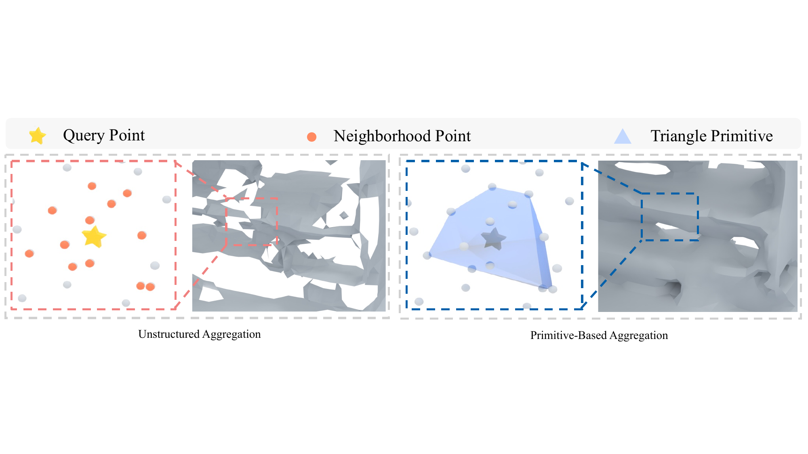

# PrimitiveUDF

Official implementation of **PrimitiveUDF: Primitive-Based Unsigned Distance Fields for Surface Reconstruction from Point Clouds** (ECCV 2026).

**Xin Deng, Bo Yang, Yifei Shi, Bing Wang**

Spatial Intelligence Group, The Hong Kong Polytechnic University · NUDT

[](assets/teaser.pdf)

## Installation

Install Git LFS, a C++ compiler and the CUDA toolkit, then:

```bash
git lfs pull
conda env create -f environment.yml
conda activate primitiveudf-v3
(cd networks/custom_mc && python setup.py build_ext --inplace)
```

## Prepare data

Download the original meshes through the dataset providers:

- **[ScanNet](https://github.com/ScanNet/ScanNet#scannet-data):** request access following the official instructions, then download the scene meshes (`*_vh_clean_2.ply`).
- **[Matterport3D](https://github.com/niessner/Matterport#dataset-download):** request access and download/extract the `region_segmentations` archives containing the region meshes.
- **[ShapeNet Cars](https://huggingface.co/datasets/ShapeNet/ShapeNetCore-archive):** request access to ShapeNetCore, download the v1 archive and extract category `02958343` with its original `model.obj` meshes.

Arrange the extracted files as follows, or update `preparation.mesh_root` and
`preparation.mesh_pattern` in the dataset YAML:

```text
raw/
  scannet/scans/<scene>/<scene>_vh_clean_2.ply
  matterport3d/<house>/region_segmentations/<region>.ply
  ShapeNetCore.v1/02958343/<model>/model.obj
```

The train/validation/test lists are in [splits/](splits/); each config selects
its list through `data.split_file`. Run the corresponding preparation command:

```bash
python tools/prepare_data.py --config-name scannet
python tools/prepare_data.py --config-name matterport3d
python tools/prepare_data.py --config-name shapenet_cars
```

The script normalizes each original mesh into the unit cube `[-0.5, 0.5]^3`
by centering its bounding box at the origin and uniformly scaling its longest
side to one. It then samples surface points and three sets of Gaussian-perturbed
queries, and computes unsigned distances to the normalized mesh triangles
without making the mesh watertight. Sampling settings and output paths
are defined in [configs_hydra/](configs_hydra/). Each sample contains:

```text
on_surface_points.npz          # points, normals
boundary_<sigma>_samples.npz   # points, nearest_points, df
preparation.json              # source fingerprint, sampling settings, transform
```

All datasets use the same loader and non-negative `df` labels.

## Train

```bash
python train.py --config-name scannet
python train.py --config-name matterport3d
python train.py --config-name shapenet_cars
```

Dataset paths, model, training and evaluation settings are in the corresponding
YAML file under [configs_hydra/](configs_hydra/).

## Reconstruct and evaluate

Pretrained checkpoints for all three datasets are in [pretrained/](pretrained/).
For example:

```bash
python tools/reconstruct_mesh.py --config-name matterport3d \
  --checkpoint pretrained/matterport3d.ckpt --output-dir outputs/matterport3d_mesh
python tools/evaluate_mesh.py --config-name matterport3d \
  --mesh-dir outputs/matterport3d_mesh
```

Use the corresponding config and checkpoint for ScanNet or ShapeNet Cars.

## Citation

If you use this code, please cite our paper:

```bibtex
@inproceedings{deng2026primitiveudf,
  title  = {{PrimitiveUDF}: Primitive-Based Unsigned Distance Fields for Surface Reconstruction from Point Clouds},
  author = {Deng, Xin and Yang, Bo and Shi, Yifei and Wang, Bing},
  booktitle = {European Conference on Computer Vision (ECCV)},
  year   = {2026}
}
```
